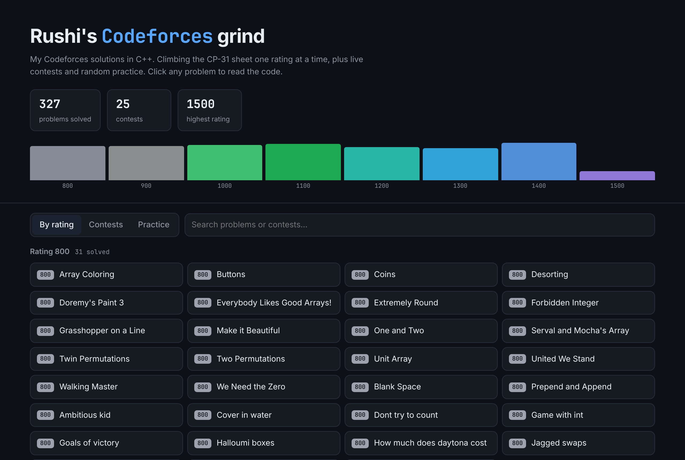

# Codeforces solutions

My C++ solutions to Codeforces problems: the CP-31 sheet worked through rating by rating (800 to 1500), problems from live contests, and some random practice.

**Browse them here: [rushipatel296.github.io/Cf](https://rushipatel296.github.io/Cf/)**

[](https://rushipatel296.github.io/Cf/)

## What's inside

| Folder | What it is |
| --- | --- |
| `CP_31/<rating>/` | Problems from the CP-31 sheet, grouped by rating |
| `Contests/<DDMMYY>_<div>/` | Problems from contests I took part in |
| `Random_Practice/` | Anything else |

Each folder has a hidden `.cph/` directory with the problem link and sample tests, saved by [Competitive Companion](https://github.com/jmerle/competitive-companion) and the CPH VS Code extension.

## Running a solution

```bash
g++ -std=c++20 -O2 CP_31/1400/C_Queen.cpp -o queen
./queen < input.txt
```

Most files include a small debug template that writes to `Error.txt` locally. Compile with `-DONLINE_JUDGE` to switch it off, the same way Codeforces does.

## Checking every solution against its samples

```bash
python3 scripts/check.py      # add -v to list every file
```

This compiles every `.cpp` and runs it on its saved sample tests. Some problems accept more than one correct answer, so a "differs" result doesn't always mean the solution is wrong.

## The site

`site/` is a static page with no build step. `scripts/build_site.py` collects every solution into `site/data.json`, and a GitHub Actions workflow publishes it to GitHub Pages on every push to `main`. To preview it locally:

```bash
python3 scripts/build_site.py
python3 -m http.server -d site
```
